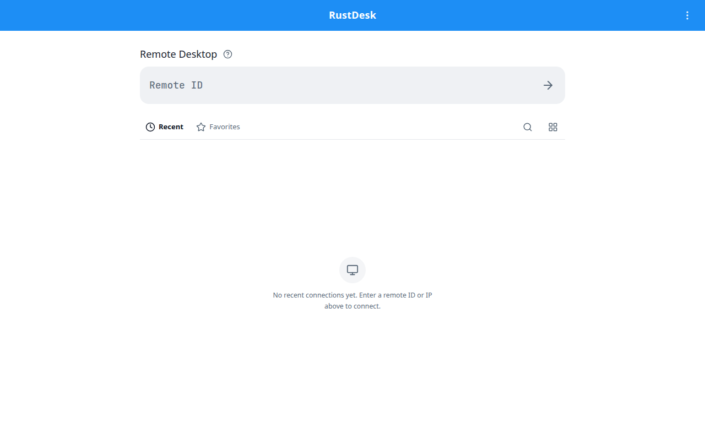

# RustDesk Web Client

Unofficial browser client for [RustDesk](https://github.com/rustdesk/rustdesk). It is not affiliated with, endorsed by, or maintained by the RustDesk authors.

The page talks to a Node.js gateway. The gateway opens the RustDesk session and forwards video to the browser. The browser decodes with WebCodecs and sends pointer, keyboard, and touch input back through the same WebSocket.

This tree is an alpha for controlled development. It is not a public release and is not recommended for exposure on the internet. The release gate in [CHANGELOG.md](CHANGELOG.md) is not met. No git tag, GitHub Release, package, or container image is published from this repository.

Copyright (C) 2026 suijiafeng. Licensed under the GNU Affero General Public License version 3 only. See [LICENSE](LICENSE).

[中文说明](README.zh-CN.md)

## Requirements

- Node.js 24 (see `.nvmrc`)
- Yarn 1.22.22

## Develop

```sh
yarn install --frozen-lockfile
cp .env.example .env
yarn dev
```

The web app is at http://127.0.0.1:5173. It proxies `/api` and `/ws` to the gateway on port 3001.

```sh
yarn typecheck
yarn lint
yarn test
yarn build
yarn start
```

`yarn lint` is the TypeScript check. `yarn start` serves the built gateway. Set `WEB_ROOT` to `apps/web/dist` after `yarn build` if that process should also serve the page.

## Deploy

See [deploy/README.md](deploy/README.md). Production mode refuses to start until `RUSTDESK_GATEWAY_TOKEN` is set. The local image name is `rustdesk-web-client:local`. Do not push it.

WebCodecs needs localhost or HTTPS. The nginx profile in Compose forwards `/ws` as a WebSocket.

## Layout

| Path | Role |
|---|---|
| `apps/web` | React client |
| `apps/gateway` | Express gateway and WebSocket session |
| `packages/protocol` | Frame codec and protobuf definitions |
| `packages/shared` | Messages shared by the client and gateway |
| `deploy` | Dockerfile, Compose, and the TLS proxy example |

Trust boundaries are described in [docs/architecture.md](docs/architecture.md).

## Interface

This is the local connect form with no saved devices and no remote session. It does not show a controlled desktop.



A remote-operation recording was not made. No controlled device was available.

## Status

Automated tests cover the protocol, gateway, and browser logic. Real Windows, macOS, Linux, Android, and iOS sessions have not been run. The compatibility list in `apps/web/src/lib/compatibilityMatrix.ts` stays `untested` until there is evidence.
