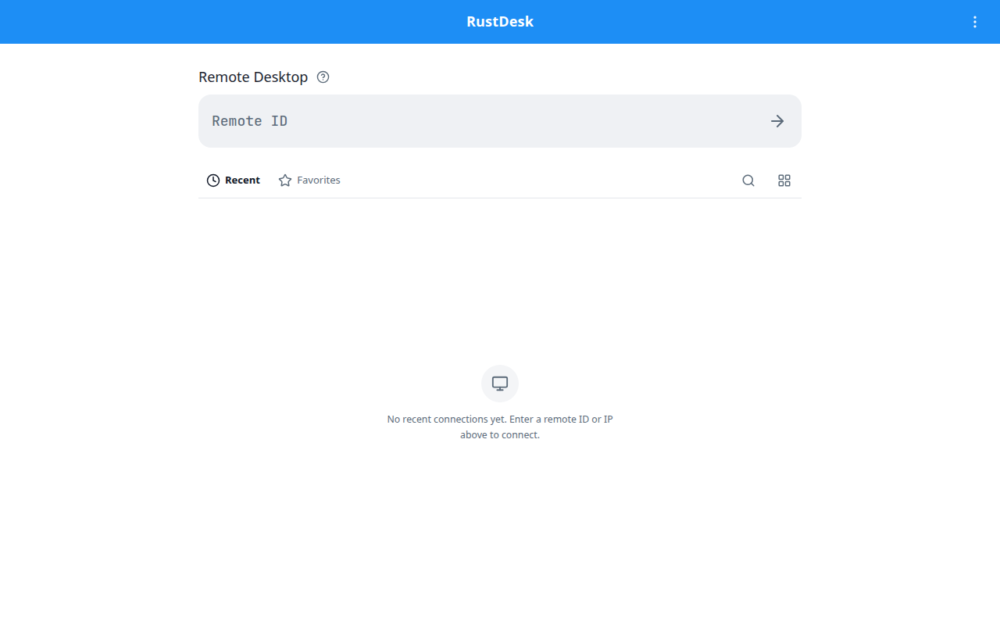

# RustDesk 网页客户端

参考交互的独立运行候选见 [reference-client/](reference-client/README.md)。候选与根目录现有入口互不替换。

这是 [RustDesk](https://github.com/rustdesk/rustdesk) 的非官方浏览器客户端，与 RustDesk 作者没有隶属、背书或维护关系。

网页把操作交给本仓库的 Node.js 网关。网关建立 RustDesk 会话，并把画面经 WebSocket 交给浏览器。浏览器使用 WebCodecs 解码，再把指针、键盘和触控发回同一条连接。

当前代码是受控开发用的 alpha，不是公开发布版本，不建议暴露到公网。[CHANGELOG.md](CHANGELOG.md) 里的发布门禁没有通过。本仓库不打 git 标签，不创建 GitHub Release，也不发布软件包或容器镜像。

版权 (C) 2026 suijiafeng。仅以 GNU Affero General Public License 第 3 版授权，见 [LICENSE](LICENSE)。

[English](README.md)

## 环境

- Node.js 24（见 `.nvmrc`）
- Yarn 1.22.22

## 本地开发

```sh
yarn install --frozen-lockfile
cp .env.example .env
yarn dev
```

网页在 http://127.0.0.1:5173，并把 `/api` 与 `/ws` 代理到 3001 端口的网关。

```sh
yarn typecheck
yarn lint
yarn test
yarn build
yarn start
```

`yarn lint` 就是类型检查。`yarn start` 启动已构建的网关。若要由这个进程同时提供网页，先执行 `yarn build`，再把 `WEB_ROOT` 设为 `apps/web/dist`。

## 部署

步骤、升级、回滚和故障排查见 [deploy/README.md](deploy/README.md)。`NODE_ENV=production` 时必须设置真实的 `RUSTDESK_GATEWAY_TOKEN`，否则进程拒绝启动。本地镜像名是 `rustdesk-web-client:local`，不要推送到仓库。

远程浏览器播放需要 localhost 或 HTTPS。Compose 里的 nginx profile 会把 `/ws` 升级为 WebSocket。

## 目录

| 路径 | 职责 |
|---|---|
| `apps/web` | React 客户端 |
| `apps/gateway` | Express 网关和 WebSocket 会话 |
| `packages/protocol` | 帧编码和 protobuf 定义 |
| `packages/shared` | 客户端与网关共用的消息 |
| `deploy` | Dockerfile、Compose 和 TLS 代理示例 |

信任边界见 [docs/architecture.md](docs/architecture.md)。

## 界面

下面是没有保存设备、也没有远端会话的本地连接页，不是被控桌面。



没有录制远程操作视频，因为没有被控设备。

## 状态

自动化测试覆盖协议、网关和浏览器逻辑。尚未在 Windows、macOS、Linux、Android 或 iOS 上做过真机会话。`apps/web/src/lib/compatibilityMatrix.ts` 里的组合保持为 `untested`，直到有证据。
